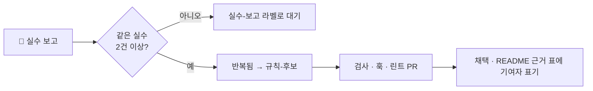

# 🤝 참여하기

이 템플릿은 **실제로 본 실수만 규칙으로 만든다**는 원칙으로 자랍니다. 혼자서는 같은 실수를 두 번 보기 어렵지만, 여럿이면 금방 모입니다.

## 참여 방법

| 하고 싶은 것 | 어디에 | 형식 |
| --- | --- | --- |
| 에이전트가 한 실수 알리기 | [이슈 · 🐞 에이전트 실수 보고](../../issues/new?template=agent-mistake.yml) | 무엇을 시켰나 · 무슨 실수 · 게이트가 잡았나 |
| 새 검사 · 훅 제안 | [이슈 · 💡 하네스 개선 제안](../../issues/new?template=improvement.yml) | 어떤 실수를 막나 · 몇 번 봤나 |
| 써 본 후기 · 적용 사례 | [Discussions · Show and tell](../../discussions/categories/show-and-tell) | 언어 · 규모 · 켠 기능 · 좋았던 점 · 귀찮았던 점 |
| 코드 기여 | Pull Request | 막는 실수 · 근거 이슈 링크 · 테스트 |
| 내 방식대로 바꿔 쓰기 | Fork · Use this template | 자유롭게 |

## 실수가 규칙이 되는 과정

| 라벨 | 뜻 |
| --- | --- |
| `실수-보고` | 에이전트 실수 보고가 들어옴 |
| `반복됨` | 다른 사람도 같은 실수를 봄 (2건 이상) |
| `규칙-후보` | 검사 · 훅으로 막을 만함 |
| `채택` | 템플릿에 반영됨 |

## PR 기준

- 막으려는 실수가 **이슈로 1건 이상** 있어야 합니다 (상상한 실수는 받지 않습니다)
- `npm run test:harness` 에 테스트를 추가합니다
- 외부 의존성은 추가하지 않습니다 (Node 기본 모듈만)
- 하네스 파일은 보호 목록이라 PR에 `harness-approved` 라벨이 붙어야 CI가 통과합니다 (메인테이너가 붙입니다)
