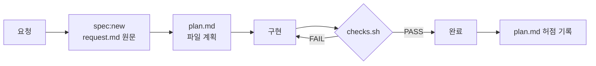

<div align="center">

# 🧰 harness-template

**AI 코딩 에이전트가 "했다"고 말하는 대신, 게이트가 "했다"고 말하게 만드는 최소 하네스**


</div>

---

## ✨ 무엇을 해 주나

| 기능 | 동작 | 방식 |
| --- | --- | --- |
| 🚦 완료 게이트 | 검사가 실패하면 에이전트가 작업을 끝내지 못함 | Stop 훅 |
| 🔒 보호 파일 | 하네스 · 의존성 · 계약 파일 변경을 차단 | `protected.txt` |
| 🗺️ 작업 범위 | 계획에 없던 파일 변경을 경고 | `plan.md` ↔ `git diff` |
| 🧪 테스트 약화 감지 | 기존 테스트의 단언 삭제·변경을 경고 | `git diff` |
| 📁 작업 폴더 밖 쓰기 차단 | `$HOME` · `/tmp` 쓰기를 실행 전에 막음 | PreToolUse 훅 |
| 📝 요청 원문 고정 | 작업마다 요청 원문과 계획을 남김 | `.agents/specs/` |

> 외부 의존성 0개 · Node 22만 있으면 동작 · 어떤 언어 프로젝트에도 얹을 수 있음

---

## 🚀 시작하기

**1. 이 템플릿으로 저장소 만들기**

상단 **`Use this template`** → **`Create a new repository`**

**2. 내 프로젝트에 맞추기 (5분)**

| 파일 | 할 일 |
| --- | --- |
| `AGENTS.md` | 프로젝트 한 줄 소개와 고유 규칙 1~2개 |
| `.agents/protected.txt` | 계약 · 설정 파일 경로 추가 |
| `docs/domain/` | `_template.md`를 복사해 도메인 규칙 작성 |
| `.agents/checks.sh` | 언어가 Node가 아니면 1번 블록에 검사 명령 추가 |

**3. 게이트 확인**

```bash
bash .agents/checks.sh
```

---

## 🔁 작업 흐름



```bash
npm run spec:new -- cart-qty        # .agents/specs/0001-cart-qty/ 생성
git switch -c task/0001-cart-qty    # 브랜치 번호로 게이트가 계획을 찾음
bash .agents/checks.sh              # 에이전트는 Stop 훅이 자동 실행
```

---

## 📂 구조

```text
.
├── AGENTS.md                  # 에이전트 진입점 (50줄 이내)
├── CLAUDE.md                  # @AGENTS.md 한 줄
├── docs/
│   ├── architecture.md        # 구조 · 경계 규칙
│   └── domain/                # 도메인 규칙 원본 + 담당 경로
├── .agents/
│   ├── checks.sh              # 게이트
│   ├── protected.txt          # 항상 보호 목록
│   ├── specs/                 # 작업별 request.md · plan.md
│   └── scripts/               # 검사 · 훅 스크립트 + 테스트
├── .claude/settings.json      # Stop · PreToolUse 훅
└── .github/workflows/         # PR마다 같은 게이트
```

---

## 🚦 차단과 경고

| 상황 | 결과 | 푸는 방법 |
| --- | --- | --- |
| 보호 파일 변경 | ❌ 차단 | 사람이 `ALLOW_PROTECTED=1` 또는 PR에 `harness-approved` 라벨 |
| 작업 기록 없음 | ❌ 차단 | `request.md` · `plan.md` 채우기 |
| 프로젝트 검사 실패 | ❌ 차단 | 고치기 |
| 계획 밖 파일 변경 | ⚠️ 경고 | `plan.md` "계획 밖 변경 이유"에 한 줄 |
| 기존 테스트 단언 삭제 | ⚠️ 경고 | 의도한 변경인지 리뷰 |
| 작업 폴더 밖 쓰기 | ⛔ 실행 전 차단 | 저장소 안 `.tmp/` 사용 |

> 경고를 실패로 바꾸려면 `SCOPE_STRICT=1 bash .agents/checks.sh`

---

## 🌱 키우는 규칙

이 템플릿은 일부러 작습니다. **실제로 본 실수만** 추가합니다.

| 언제 | 무엇을 |
| --- | --- |
| 첫날 | 이 템플릿 그대로 |
| 같은 실수가 **2번** 나오면 | 그 실수만 막는 검사 · 훅 · 린트 한 줄 |
| 코드로 확인할 수 있는 규칙이 생기면 | 문서 대신 린트 · 테스트로 |
| 작업이 커지면 | `plan.md`를 prd · sdd · trace로 나누기 |
| 에이전트가 여럿이면 | 구현 · 검증 역할 분리 (검증은 다른 모델) |

**하지 않는 것**

- ❌ 규칙을 여러 곳에 복사하기 → 원본은 `docs/` 한 곳
- ❌ "모든 문서를 읽어라" 같은 긴 지시 → 효과 없음
- ❌ 상상한 실수를 미리 막기 → 실제 실수와 다름

---

## 🔬 근거

모든 규칙은 [harness-lab](https://github.com/kyungchan3007/Harness) 실험 결과에서 나왔습니다.

| 발견 | 수치 | 실험 |
| --- | --- | --- |
| 요약해서 넘기면 요구가 사라짐 | 정답률 46% → 원문 고정 100% | 0016 · 0022 |
| 문서 지시보다 실행되는 검사 | 숨겨진 테스트 93.7% → 99.1% | 0037 |
| 링크만 두면 아무도 안 읽음 | 온톨로지 읽기 26번 중 0번 | 0037 |
| 규칙이 저장소에 있으면 스스로 찾음 | 위치 안내 없이 5/5 | 0039 |
| 실제로 반복된 실수는 예상과 다름 | 작업 폴더 밖 쓰기 5번 중 3번 | 0039 |

---

## ❓ 자주 묻는 것

<details>
<summary><b>Claude Code가 아니어도 쓸 수 있나요?</b></summary>

게이트(`checks.sh`)와 CI는 어떤 에이전트나 사람에게도 동작합니다. 훅 두 개(Stop · PreToolUse)만 Claude Code 전용입니다.

</details>

<details>
<summary><b>에이전트가 보호 파일을 스스로 승인하면요?</b></summary>

CI는 PR 라벨로 승인하므로 로컬에서 우회해도 PR에서 다시 걸립니다. 라벨은 에이전트도 `gh`로 붙일 수 있으니, 저장소 설정에서 라벨·머지 권한을 사람에게만 두세요.

</details>

<details>
<summary><b>브랜치에 번호가 없으면요?</b></summary>

범위 검사와 작업 기록 검사는 건너뛰고, 보호 파일과 프로젝트 검사만 돌립니다.

</details>

---

## 🧪 하네스 자체 테스트

```bash
npm run test:harness
```

---

<div align="center">

MIT License · made with [harness-lab](https://github.com/kyungchan3007/Harness)

</div>
