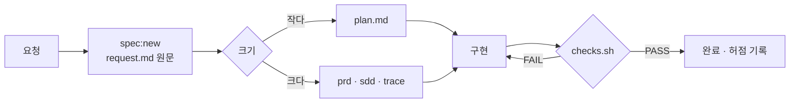

<div align="center">

# 🧰 harness-template

**AI 코딩 에이전트가 "했다"고 말하는 대신, 게이트가 "했다"고 말하게 만드는 최소 하네스**


</div>

---

## 🙋 왜 만들었나

개발자라면 결국 같은 고민을 합니다. **최소 비용으로 서비스 품질을 어떻게 올릴까.**

AI 코딩 에이전트를 실무에 쓰면서 규칙과 문서를 계속 늘렸지만, 그게 정말 효과가 있는지는 몰랐습니다. 그래서 하네스 기능을 하나씩 떼어 [harness-lab](https://github.com/kyungchan3007/Harness)에서 실험으로 확인했고, **효과가 확인된 것만** 이 템플릿에 남겼습니다.

혼자 얻은 결과라 아직 좁습니다. 같이 써 보고 경험을 나누면 더 정확해질 것 같아 공개합니다. **Fork 해서 가져가셔도 좋고, 이슈를 남겨 주셔도 좋습니다.**

---

## 📈 직접 실험해서 얻은 것

> harness-lab에서 같은 과제를 조건만 바꿔 반복 실행하고, 숨겨진 테스트로 채점한 결과입니다

### 🎯 정확도를 올린 것

| 바꾼 것 | 전 | 후 | 실험 |
| --- | --- | --- | --- |
| 요구를 요약하지 않고 원문 그대로 넘기기 | 46% | **100%** | 0016 · 0022 |
| 규칙을 문서 대신 실행되는 검사로 | 93.7% | **99.1%** | 0037 |
| 애매하면 지어내지 말고 묻게 하기 (Haiku) | 27% | **87%** | 0027 · 0028 |
| 묻고 답을 받는 큰 모델 | 53% | **100%** | 0027 · 0028 |

### 💰 비용을 줄인 것

| 바꾼 것 | 전 | 후 | 실험 |
| --- | --- | --- | --- |
| 작은 작업은 역할을 나누지 않고 큰 모델 하나로 (정확도 둘 다 100%) | $1.35 | **$0.98** (약 27%↓) | 0028 · 0029 |
| 문서 대신 검사를 주입 (점수는 오히려 상승) | $0.97 | **$0.86** (약 11%↓) | 0037 |
| 모델은 단가가 아니라 단가 × 쓴 양으로 고르기 | Sonnet $1.41 | **Opus $0.98** | 0026 · 0028 |

### 🧹 안 해도 되는 것 (해 봤는데 효과 없음)

| 흔히 하는 것 | 결과 | 실험 |
| --- | --- | --- |
| 문서형 온톨로지 · 개념 정리 문서 추가 | 92.1% (안 했을 때 93.7%와 같음) | 0037 |
| AGENTS.md 에 "이 문서를 읽어라" 링크 | 26번 중 **0번** 읽음 | 0037 |
| 규칙 문서 위치를 일일이 안내 | 안내 없이도 **5번 중 5번** 스스로 찾음 | 0039 |

### 🐞 실제로 반복된 실수 (예상과 달랐던 것)

| 예상한 실수 | 실제로 반복된 실수 | 실험 |
| --- | --- | --- |
| 요청에 없는 규칙을 놓친다 | 5번 모두 지킴 (빠진 규칙 4개 기준) | 0039 |
| — | 게이트 로그를 작업 폴더 밖에 씀 (**5번 중 3번**) → 이 템플릿의 밖 쓰기 차단 훅 | 0039 |

> 그래서 이 템플릿은 **상상한 실수가 아니라 실제로 본 실수만** 막습니다

---

## ✨ 무엇을 해 주나

| 기능 | 동작 | 방식 |
| --- | --- | --- |
| 🚦 완료 게이트 | 검사가 실패하면 에이전트가 작업을 끝내지 못함 | Stop 훅 |
| 🔒 보호 파일 | 하네스 · 의존성 · 계약 파일 변경을 차단 | `protected.txt` |
| 🔁 Quick · Full Loop | 작업 크기에 맞게 문서와 검사 범위를 자동으로 나눔 | `loop-mode` |
| 🗺️ 작업 범위 | 계획에 없던 파일 변경을 경고 | 파일 계획 ↔ `git diff` |
| 🧪 테스트 약화 감지 | 기존 테스트의 단언 삭제·변경을 경고 | `git diff` |
| 📁 작업 폴더 밖 쓰기 차단 | `$HOME` · `/tmp` 쓰기를 실행 전에 막음 | PreToolUse 훅 |
| 📝 작업 의도 (Intent) | 요청 원문 · prd · sdd · trace 템플릿 | `.agents/specs/` |
| 🎼 오케스트레이션 뼈대 | 여러 에이전트용 역할 · 패턴 지침서 (선택) | `.agents/orchestration/` |

> 외부 의존성 0개 · Node 22만 있으면 동작 · 어떤 언어 프로젝트에도 얹을 수 있음

---

## 🚀 시작하기

**1. 이 템플릿으로 저장소 만들기**

상단 **`Use this template`** → **`Create a new repository`**

**2. 내 프로젝트에 맞추기 (5분)**

| 파일 | 할 일 |
| --- | --- |
| `AGENTS.md` | 프로젝트 한 줄 소개와 고유 규칙 1~2개 |
| `.agents/protected.txt` | 계약 · 설정 파일 경로 추가 |
| `docs/domain/` | `_template.md`를 복사해 도메인 규칙 작성 |
| `.agents/checks.sh` | 언어가 Node가 아니면 1번 블록에 검사 명령 추가 |

**3. 게이트 확인**

```bash
bash .agents/checks.sh
```

---

## ⏱️ 5분 따라하기

```bash
npm run spec:new -- hello                 # 1. 작업 폴더 (Quick Loop)
git switch -c task/0001-hello             # 2. 번호 있는 브랜치
# 3. .agents/specs/0001-hello/request.md 에 요청 원문, plan.md "무엇을" 한 줄
mkdir -p src && echo 'export const hello = () => "hi";' > src/hello.ts
bash .agents/checks.sh                    # 4. ⚠️ 계획 밖 변경: src/hello.ts
# 5. plan.md "파일 계획"에 - src/hello.ts 추가
bash .agents/checks.sh                    # 6. ✅ ALL PASS
echo "# 실수" >> AGENTS.md && bash .agents/checks.sh   # 7. ❌ 보호 파일 차단
git checkout AGENTS.md                    # 8. 되돌리기
```

> Claude Code로 열면 4·6번을 Stop 훅이 자동으로, 작업 폴더 밖 쓰기는 PreToolUse 훅이 실행 전에 막습니다

---

## 🔁 Quick Loop · Full Loop

작업 크기에 맞게 남길 문서와 돌릴 검사를 나눕니다. 루프는 작업 폴더를 보고 자동으로 정해집니다.

| 루프 | 언제 | 남길 문서 | 게이트 | 만들기 |
| --- | --- | --- | --- | --- |
| ⚡ **Quick** | 작은 변경 · 설계 고민 적음 | request · plan | typecheck · lint · test | `npm run spec:new -- 이름` |
| 🧭 **Full** | 경계·계약 변경 · 여러 세션 · 여러 에이전트 | request · prd · sdd · trace | Quick + build · e2e | `npm run spec:new -- 이름 --full` |



- 판정: 작업 폴더에 prd·sdd가 있으면 Full, 없으면 Quick (`LOOP=full`로 강제)
- Quick인데 바뀐 파일이 10개를 넘으면 게이트가 Full로 올리라고 경고
- Quick으로 시작해 커지면 plan.md를 prd · sdd · trace로 나누면 됨

```bash
npm run spec:new -- cart-qty        # .agents/specs/0001-cart-qty/ (Quick)
git switch -c task/0001-cart-qty    # 브랜치 번호로 게이트가 작업 폴더를 찾음
bash .agents/checks.sh              # 에이전트는 Stop 훅이 자동 실행
```

---

## 📝 작업 의도 (Intent)

작업마다 "무엇을 · 왜 · 어떻게"를 남깁니다. **원본은 request.md 원문** 하나이고 나머지는 거기서 나온 문서입니다.

| 파일 | 답하는 질문 | 핵심 칸 | 루프 |
| --- | --- | --- | --- |
| `request.md` | 무엇을 요청받았나 | 원문 그대로 (요약 금지 · 고정) | 둘 다 |
| `plan.md` | 작은 작업의 전부 | 무엇을 · 애매한 곳 · 파일 계획 · 완료 기준 · 허점 | Quick |
| `prd.md` | 무엇을 · 왜 | 문제 · 목표 · 비목표 · 애매한 곳 · 완료 기준 | Full |
| `sdd.md` | 어떻게 | 접근 · 대안 · 파일 계획 · 위험 · 검증 계획 · 달라진 점 | Full |
| `trace.md` | 어떻게 판단했나 | 단계별 판단 · 이유 · 허점 | Full |

> 애매한 값은 지어내지 않고 묻습니다. 답을 받으면 `(확인됨: 답)`, 스스로 정했으면 `(가정)`으로 표시합니다.

---

## 📂 구조

```text
.
├── AGENTS.md                  # 에이전트 진입점 (50줄 이내)
├── CLAUDE.md                  # @AGENTS.md 한 줄
├── docs/
│   ├── architecture.md        # 구조 · 경계 규칙
│   └── domain/                # 도메인 규칙 원본 + 담당 경로
├── .agents/
│   ├── checks.sh              # 게이트
│   ├── protected.txt          # 항상 보호 목록
│   ├── specs/                 # 작업별 의도 문서
│   │   ├── _template/         #   Quick: request · plan
│   │   └── _template-full/    #   Full: request · prd · sdd · trace
│   ├── orchestration/         # (선택) 여러 에이전트를 엮는 뼈대
│   └── scripts/               # 검사 · 훅 스크립트 + 테스트
├── .claude/settings.json      # Stop · PreToolUse 훅
└── .github/workflows/         # PR마다 같은 게이트
```

---

## 🚦 차단과 경고

| 상황 | 결과 | 푸는 방법 |
| --- | --- | --- |
| 보호 파일 변경 | ❌ 차단 | 사람이 `ALLOW_PROTECTED=1` 또는 PR에 `harness-approved` 라벨 |
| 작업 기록 없음 | ❌ 차단 | Quick: request · plan / Full: request · prd · sdd · trace 채우기 |
| 프로젝트 검사 실패 | ❌ 차단 | 고치기 |
| 계획 밖 파일 변경 | ⚠️ 경고 | plan.md 또는 sdd.md "계획 밖 변경 이유"에 한 줄 |
| 기존 테스트 단언 삭제 | ⚠️ 경고 | 의도한 변경인지 리뷰 |
| Quick인데 10개 넘게 변경 | ⚠️ 경고 | `--full` 로 문서 나누기 |
| 작업 폴더 밖 쓰기 | ⛔ 실행 전 차단 | 저장소 안 `.tmp/` 사용 |

> 경고를 실패로 바꾸려면 `SCOPE_STRICT=1 bash .agents/checks.sh`

---

## 🎼 오케스트레이션 (선택)

> **여러 에이전트가 하나의 목표를 위해 일할 때, 누가 · 무엇을 · 어떤 순서로 · 무엇을 넘겨받아 · 어떻게 합칠지 정하는 것**

기본은 꺼져 있습니다. 칸만 있는 뼈대라서 켤 때 채우면 됩니다. MCP는 연결 수단일 뿐 오케스트레이션 자체가 아닙니다.

**6요소**

| 요소 | 질문 | 채울 파일 |
| --- | --- | --- |
| 분해·배정 | 일을 어떻게 나누고 누구에게 주나 | `roles/` · `TASKS.md` |
| 흐름 | 순서대로인가, 동시인가 | `patterns/` |
| 전달물 | 다음 에이전트에게 무엇을 넘기나 | `handoff.md` |
| 상태 공유 | 지금 누가 뭘 하고 있나 | `TASKS.md` |
| 합류·판정 | 결과를 어떻게 합치고 누가 통과시키나 | `verdict.md` · 게이트 |
| 충돌 방지 | 같은 파일·작업이 겹치지 않게 | `TASKS.md` · 1작업 = 1브랜치 |

**4패턴**

| 패턴 | 모양 | 맞는 상황 |
| --- | --- | --- |
| 역할 분리 | 설계자 → 구현자 → 검증자 | 만든 쪽이 자기 작업을 채점하면 안 될 때 |
| 병렬 분산 | 한 일을 여러 에이전트가 동시에 | 독립적인 작업이 많을 때 |
| 감독자-작업자 | 조율자가 나눠 주고 결과를 모음 | 한 세션 컨텍스트에 안 들어가는 큰 작업 |
| 토론·교차 검토 | 두 에이전트가 서로의 안을 비판 | 되돌리기 비싼 설계 결정 |

**지침서 필수 칸** (하네스 테스트가 빠진 칸을 잡음)

| 지침서 | 반드시 있어야 하는 칸 |
| --- | --- |
| 역할 `roles/*.md` | 목적 · 먼저 읽을 것 · 할 일 · 하지 않을 것 · 받는 것 · 넘기는 것 · 완료 기준 |
| 패턴 `patterns/*.md` | 언제 쓰나 · 참여 역할 · 흐름 · 단계 · 전달물 · 합류·판정 · 충돌 방지 · 주의 |

> 작은 작업은 켜지 마세요. 정확도는 같았고, 역할을 나눈 조합이 큰 모델 하나보다 약 1.4배 비쌌습니다 (harness-lab 0028 · 0029)

---

## 🌱 키우는 규칙

이 템플릿은 일부러 작습니다. **실제로 본 실수만** 추가합니다.

| 언제 | 무엇을 |
| --- | --- |
| 첫날 | 이 템플릿 그대로 |
| 같은 실수가 **2번** 나오면 | 그 실수만 막는 검사 · 훅 · 린트 한 줄 |
| 코드로 확인할 수 있는 규칙이 생기면 | 문서 대신 린트 · 테스트로 |
| 작업이 커지면 | Full Loop로 (`--full`) |
| 에이전트가 여럿이면 | `.agents/orchestration/` 켜기 (패턴 하나부터) |

**하지 않는 것**

- ❌ 규칙을 여러 곳에 복사하기 → 원본은 `docs/` 한 곳
- ❌ "모든 문서를 읽어라" 같은 긴 지시 → 효과 없음
- ❌ 상상한 실수를 미리 막기 → 실제 실수와 다름

---

## 🔄 업데이트

템플릿으로 만든 저장소는 원본 변경을 자동으로 받지 않습니다. 하네스 스크립트만 가져오면 됩니다.

```bash
git remote add harness https://github.com/kyungchan3007/harness-template
git fetch harness
git checkout harness/main -- .agents/scripts .agents/checks.sh
ALLOW_PROTECTED=1 bash .agents/checks.sh   # 하네스 파일은 보호 목록이라 사람 승인으로 확인
```

> 바뀐 내용은 [CHANGELOG](CHANGELOG.md)에 있습니다

---

## 🤝 참여하기

| 하고 싶은 것 | 어디에 |
| --- | --- |
| 🐞 에이전트가 한 실수 알리기 | [실수 보고 이슈](../../issues/new?template=agent-mistake.yml) |
| 💡 새 검사 · 훅 제안 | [개선 제안 이슈](../../issues/new?template=improvement.yml) |
| 💬 써 본 후기 · 적용 사례 | [Discussions · Show and tell](../../discussions/categories/show-and-tell) |
| 🍴 내 방식대로 바꿔 쓰기 | Fork · Use this template (원본과 무관하게 자유롭게) |

- **원본에는 이슈로만 기여합니다.** 외부 PR은 받지 않고, 좋은 제안은 메인테이너가 직접 반영합니다 (원본이 섞이지 않게)
- 같은 실수 보고가 **2건 이상** 모이면 규칙 후보가 되고, 채택되면 위 실험 표에 기여자와 함께 올라갑니다
- 자세한 흐름은 [CONTRIBUTING](CONTRIBUTING.md)

---

## ❓ 자주 묻는 것

<details>
<summary><b>Claude Code가 아니어도 쓸 수 있나요?</b></summary>

게이트(`checks.sh`)와 CI는 어떤 에이전트나 사람에게도 동작합니다. 훅 두 개(Stop · PreToolUse)만 Claude Code 전용입니다.

</details>

<details>
<summary><b>에이전트가 보호 파일을 스스로 승인하면요?</b></summary>

내 저장소에서 PR로 작업한다면 CI가 PR 라벨로 승인하므로 로컬에서 우회해도 PR에서 다시 걸립니다. 라벨은 에이전트도 `gh`로 붙일 수 있으니, 저장소 설정에서 라벨·머지 권한을 사람에게만 두세요.

</details>

<details>
<summary><b>브랜치에 번호가 없으면요?</b></summary>

범위 검사와 작업 기록 검사는 건너뛰고, 보호 파일과 프로젝트 검사만 돌립니다.

</details>

---

## 🧪 하네스 자체 테스트

```bash
npm run test:harness
```

---

<div align="center">

MIT License · made with [harness-lab](https://github.com/kyungchan3007/Harness)

</div>
